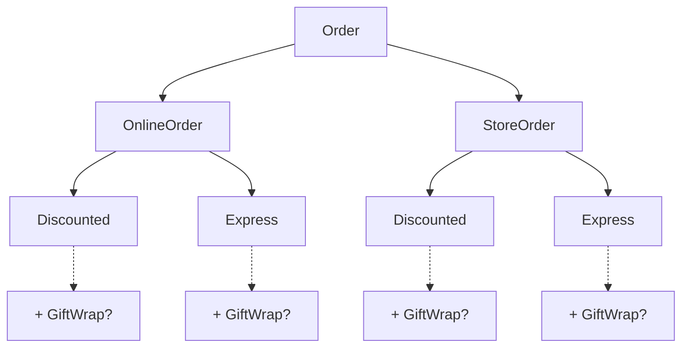
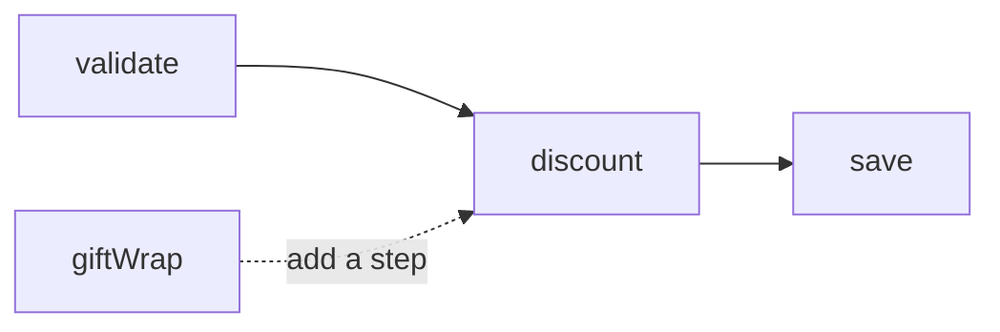

<!--
Wanted to do something else.

But no time, so let's learn about how to express AND enforce your domain while keeping it extendable and composable.

At the end examples from ePaper
-->

---
layout: agenda
kicker: Let's talk about
title: From domain rules to workflows
items:
  - { topic: Domain Creation, desc: Enforce domain invariants }
  - { topic: Errors as Values, desc: Make expected failures explicit }
  - { topic: Pipelines, desc: Compose domain transformations }
  - { topic: Adapters & DI, desc: Connect workflows to the outside world }
---

---
layout: default
kicker: The idea
title: What is functional domain modeling?
---

<v-clicks>

- Think about the problem in terms of **domain types**, not objects
- Use types to express meaningful values, choices, and rules
- Use composition over inheritance (separate data & behavior)
- Model use cases as functions that transform values
- `type CreateDownloadLink = PublicationId => URL`

</v-clicks>

<!--
What is functional domain modeling?

Instead of having a bunch of string, numbers and bools cobbled together we want to express domain rules and intent with our types and their names

We want to compose functionality, not inherit from it. Inheritance is always coupling and we do not wan't to couple. We want to stay flexible.

We want to model 
-->

---
layout: two-cols
kicker: Composition over inheritance
title: How does the system grow?
---

### Inheritance hierarchy



::right::

### Composed workflow



---
layout: default
title: Why?
---

<v-clicks>

- Avoid state wherever possible
- Explicit side effects
- Invalid values that don't exist in your domain can't be created
- Composable and extensible

</v-clicks>

---
layout: steps
kicker: Our running example
title: Checkout with a discount code
steps:
  - { title: Validate, desc: Check the cart and request }
  - { title: Decide, desc: Load and check an optional discount }
  - { title: Price, desc: Calculate the order total }
  - { title: Save, desc: Persist the order }
---

<!--
Classic eCommerce example.
Goal: persist valid order from non-empty cart.

We keep everything very simple intentionally.

A supplied discount code must exist and meet a minimum cart total to be eligible.

We use integers as our money unit, so 1699 would be 16,99€.

These steps will show why imperative style often falls short of production grade software that keeps being maintainable.
-->

---
layout: steps
kicker: From the domain to the code
title: The technical journey
steps:
  - { title: Value Creation, desc: Create valid domain values }
  - { title: Errors as Values, desc: Make expected failures explicit }
  - { title: Pipelines, desc: Compose smaller steps into workflows }
  - { title: Adapters, desc: Talk to the Database }
---

<!--
So first let's model the possible order states we can get, then return to checkout for the workflow.

Then we look at how we can treat Errors as first class citizens.

After promotions of Errors to first class citizens, we can easily start composing smaller steps into bigger workflows.

How  can our tidy domain survives contact with the outside world?
-->

---
layout: section
index: "01"
kicker: Model
title: Make invalid states unrepresentable
subtitle: Start by asking which combinations actually make sense.
---

---
layout: code
kicker: Modeling an Order as a fat struct
title: You domain is not static
---

````md magic-move
```ts
type Order = {
  orderId: string
  articles: Article[]
}
```

```ts
type Order = {
  orderId: string
  articles: Article[]
  isValidated: boolean
}
```

```ts
type Order = {
  orderId: string
  articles: Article[]
  isValidated: boolean
  isPriced: boolean
  amount?: number
}
```

```ts
type Order = {
  orderId: string
  articles: Article[]
  isValidated: boolean
  isPriced: boolean
  amount?: number
}

const order: Order = {
  orderId: '123',
  articles: [...],
  isValidated: false,
  isPriced: true,
}
```
````

<!--
This is the usual approach. An order is an order is an order.

First we start out with a simple order that has articles.

Then we might want to check if that order is legit. So we add a flag.

Add discounts, etc., add pricing component. Another flag to check if the order has been priced and a number that shows the total to bill the customer.

So what is the problem here?
-->

---
layout: steps
kicker: The boundary
title: Parse input into a domain value
steps:
  - { title: Untrusted input, desc: An unknown request arrives }
  - { title: Parse, desc: Enforce domain invariants }
  - { title: Construct, desc: Return a trusted value object }
---

<!--
How to define and enforce domain invariants to construct a value object (or aggregate) that the domain can trust as valid?

Having trusted domain objects removes the need for defensive programming:
checking validity everywhere, handling errors and failures explicitly <- Amounts to a lot of code **not building the product**
-->

---
layout: code
kicker: Model a choice
title: One type for each order state
---

````md magic-move
```ts
type Order = {
  orderId: string
  articles: Article[]
  isValidated: boolean
  isPriced: boolean
  amount?: number
}
```

```ts
type Order =
  | { kind: 'unvalidated'; orderId: string; articles: Article[] }
  | { kind: 'validated'; orderId: string; articles: Article[] }
  | { kind: 'priced'; orderId: string; articles: Article[]; amount: number }
```
````

<!--
First step: A tagged union represents **variants** of  or **perspectives** on an Order

In FP it is called a ADT

Sum Types / Product Types
-->

---
layout: code
kicker: Parse external values
title: What's wrong here?
---

````md magic-move
```ts
type Order =
  | { kind: 'unvalidated'; orderId: string; articles: Article[] }
  | { kind: 'validated'; orderId: string; articles: Article[] }
  | { kind: 'priced'; orderId: string; articles: Article[]; amount: number }
```

```ts
type Order =
  | { kind: 'unvalidated'; orderId: string; articles: Article[] }
  | { kind: 'validated'; orderId: string; articles: Article[] }
  | { kind: 'priced'; orderId: string; articles: Article[]; amount: number }

const order: Order = {
  kind: 'priced',
  articles: [],
  orderId: 'not-an-order-id',
  amount: -100,
}
```

```ts
import * as v from 'valibot'

const OrderId = v.pipe(v.string(), v.uuid(), v.brand('OrderId'))
const Amount = v.pipe(v.number(), v.safeInteger(), v.minValue(0), v.brand('Amount'))
const Article = v.object({name: v.string(), price: Amount}),

const OrderSchema = v.variant('kind', [
  v.object({ kind: v.literal('unvalidated'), orderId: OrderId, articles: v.array(Article) }),
  v.object({ kind: v.literal('validated'), orderId: OrderId, articles: v.array(Article) }),
  v.object({ kind: v.literal('priced'), orderId: OrderId, articles: v.array(Article), amount: Amount }),
])

type Order = v.InferOutput<typeof OrderSchema>

const result = v.safeParse(OrderSchema, {
  kind: 'priced', orderId: 'not-an-order-id', amount: -100,
})

result.error // true
```
````

<!--
Tagged union constraints the shape, not values.

Primitive language types are **way too wide** to enforce domain invariants.

Nobody hinders you to create an invalid aggregate

Typescript has Standard Schema to define and enforce invariants

Here valibot, same in zod, ArkType, Typia, etc.
-->

---
layout: two-cols
kicker: Same idea, different ergonomics
title: Choice types across languages
---

### Rust

```rust
enum Order {
    Unvalidated { order_id: String },
    Validated { order_id: String },
    Priced { order_id: String, amount: i64 },
}
```

### Gleam

```gleam
pub type Order {
  Unvalidated(order_id: String)
  Validated(order_id: String)
  Priced(order_id: String, amount: Int)
}
```

::right::

### Kotlin

```kotlin
sealed interface Order {
    data class Unvalidated(val orderId: String) : Order
    data class Validated(val orderId: String) : Order
    data class Priced(val orderId: String, val amount: Long) : Order
}
```

### TypeScript

```ts
type Order =
  | { kind: 'unvalidated'; orderId: string }
  | { kind: 'validated'; orderId: string }
  | { kind: 'priced'; orderId: string; amount: number }
```

<!--
Rust: Enums on Steroids

Gleam: Proper ADTs

Kotlin: sealed / data class

Typescript: Tagged Union
-->

---
layout: two-cols
kicker: Same choice, different ergonomics
title: Matching on order state
---

### Rust

```rust
match order {
    Order::Unvalidated { .. } => "Not priced".to_string(),
    Order::Validated { .. } => "Not priced".to_string(),
    Order::Priced { amount, .. } => amount.to_string(),
}
```

### Gleam

```gleam
case order {
  Unvalidated(_) -> "Not priced"
  Validated(_) -> "Not priced"
  Priced(_, amount) -> int.to_string(amount)
}
```

::right::

### Kotlin

```kotlin
when (order) {
    is Order.Unvalidated -> "Not priced"
    is Order.Validated -> "Not priced"
    is Order.Priced -> order.amount.toString()
}
```

### TypeScript

```ts
switch (order.kind) {
  case 'unvalidated': return 'Not priced'
  case 'validated': return 'Not priced'
  case 'priced': return order.amount.toString()
  default:
    const exhaustive: never = order
    return exhaustive
}
```

<!--
Using ADTs allows for powerful control flows.

More concise than if/else, but more expressive:
More paths/arms can be handles in less code

In this slightly reduced example we can i.e. check the variant to return either the amount or a string.

Rust, Gleam and Kotlins pattern matching is exhaustive.

Typescript does not have pattern matching. The ergonomics start to fall apart here a bit.

But there is a proposal to add pattern matching. JavaScript isn't typed, so it will be weird.
-->

---
layout: two-cols
kicker: One state, different behavior
title: Add a guard
---

### Rust

```rust
match order {
    Order::Priced { amount, .. } if amount > 100 => "Review",
    Order::Priced { .. } => "Process",
    _ => "Not priced",
}
```

### Gleam

```gleam
case order {
  Priced(_, amount) if amount > 100 -> "Review"
  Priced(_, _) -> "Process"
  _ -> "Not priced"
}
```

::right::

### Kotlin

```kotlin
when (order) {
    is Order.Priced if order.amount > 100 -> "Review"
    is Order.Priced -> "Process"
    else -> "Not priced"
}
```

### TypeScript

```ts
switch (order.kind) {
  case 'priced':
    return order.amount > 100 ? 'Review' : 'Process'
  case 'unvalidated':
  case 'validated': return 'Not priced'
  default:
    const exhaustive: never = order;
    return exhaustive
}
```

<!--
Example on guarding match arms.

Again Typescript hacks lack ergonomics of modern languages
-->

---
layout: section
index: "02"
kicker: Errors as values
title: Make failures visible
subtitle: What can go wrong, and how does the caller know?
---

<!--
Bridge from safeParse: validation can fail, so how do we make that failure part of the contract?
-->

---
layout: code
kicker: The imperative way
title: What is wrong with this type?
---

````md magic-move
```ts
type ParseOrder = (input: string) => Order
```

```ts
type ParseOrder = (input: string) => Order

// Compiles just fine
const parseOrder: ParseOrder = (input: string): Order => JSON.parse(input) as Order
```

```ts
type ParseOrder = (input: string) => Order

//                                     ┌─── Any string returns a valid order
//                                     │                                   ┌─── Trust me bro!
//                                     ▼                                   ▼ 
const parseOrder: ParseOrder = (input: string): Order => JSON.parse(input) as Order
```
````

<!--
What's wrong with this type signature?

The signature is lying to you and so is the typescript compiler:

This function throws and you need to know the behavior of JSON.parse to know that.

To understand the behavior of the function you call, you need to look into the implementation, which defeats the purpose of a type signature.

try/catch: callers need to know where it is needed and clutters code with error handling instead of building the product.
-->

---
layout: define
kicker: Errors as values
term: "A → Result&lt;B, Error&gt;"
definition: A function transforms <span class="accent2">A into B</span>, or
  returns an expected failure.
points:
  - Success contains B; failure contains an error.
  - The return type makes expected failure visible.
  - The caller decides how to handle it.
---

<!--
A Result makes expected failures visible in the return type.

It does not prevent the function from throwing, but linting can.

Again: modern languages like Gleam, Rust don't even allow to throw. You have to use Result to indicate failure.
-->

---
layout: code
kicker: Wrapping throwing APIs
title: Turn an exception into a Result
---

````md magic-move
```ts
// (input: string) => Order
const parseOrder = (input: string): Order => JSON.parse(input) as Order

const result = parseOrder(input) // can throw and nothing will tell you
```

```ts
import { Result as R } from '@praha/byethrow'

// (input: string) => Order
const parseOrder = (input: string): Order => JSON.parse(input) as Order

const result = parseOrder(input) // can throw and nothing will tell you
```

```ts
import { Result as R } from '@praha/byethrow'

// (input: string) => R.Result<unknown, Error>
const parseOrder = R.fn({
  try: (input: string) => JSON.parse(input) as unknown,
  catch: (cause) => new Error('Invalid JSON', { cause }),
})

const result = parseOrder(input) // will never throw
```

```ts
import { Result as R } from '@praha/byethrow'

// (input: string) => R.Result<unknown, Error>
const parseOrder = R.fn({
  try: (input: string) => JSON.parse(input) as unknown,
  catch: (cause) => new Error('Invalid JSON', { cause }),
})

const result = parseOrder(input) // will never throw

export class JsonParsingError extends ErrorFactory({
  name: "JsonParsingError",
  message: ({ input }) => `Unable to parse '${input}' to JSON.`,
  fields: ErrorFactory.fields<{ input: string }>(),
}) {}
```

```ts
import { Result as R } from '@praha/byethrow'

// (input: string) => R.Result<unknown, JsonParsingError>
const parseOrder = R.fn({
  try: (input: string) => JSON.parse(input) as unknown,
  catch: (cause) => new JsonParsingError({ input, cause }),
})

const result = parseOrder(input) // will never throw

export class JsonParsingError extends ErrorFactory({
  name: "JsonParsingError",
  message: ({ input }) => `Unable to parse '${input}' to JSON.`,
  fields: ErrorFactory.fields<{ input: string }>(),
}) {}
```

```ts
import { Result as R } from '@praha/byethrow'

// (input: string) => R.Result<unknown, JsonParsingError>
const parseOrder = R.fn({
  try: (input: string) => JSON.parse(input) as unknown,
  catch: (cause) => new JsonParsingError({ input, cause }),
})

const result = parseOrder(input)

// How can we transform `unknown` into `Order` in a safe way?
if(R.isSuccess(result)) {
  result.value // <- unknown
}
```
````

<!-- R.fn creates a reusable function with the same arguments; its catch maps a thrown value to a failure. The success value remains unknown until schema validation. Wrap only failures the caller can meaningfully handle. R is the Result namespace from byethrow. -->

---
layout: code
kicker: Wrapping throwing APIs
title: Turn an exception into a Result
---

```ts
const result = parseOrder(input)

if(R.isSuccess(result)) {
  const schemaResult = v.safeParse(OrderSchema, result.value)
  
  if (schemaResult.success) {
    const {data} = schemaResult // type Order
    
    switch (order.kind) {
      case 'unvalidated': return 'Not priced'
      case 'validated': return 'Not priced'
      case 'priced': return order.amount.toString()
      default:
        const exhaustive: never = order
        return exhaustive
    }
  }
}
```

<!-- R.fn creates a reusable function with the same arguments; its catch maps a thrown value to a failure. The success value remains unknown until schema validation. Wrap only failures the caller can meaningfully handle. R is the Result namespace from byethrow. -->

---
layout: default
kicker: A first look at monads
title: Think of an array as a box
---

```ts
const boxed = [2]
const doubled = boxed.map(n => n * 2)         // [4]
const choices = boxed.flatMap(n => [n, n * 2]) // [2, 4]
```

- **Box:** an array holds zero, one, or many values
- **map:** transform each value, keeping the array context
- **flatMap:** chain a function that returns arrays into one array

<!-- The box is an analogy, not a definition: an array can hold multiple values. A monad also has a way to put a value in the context, such as [value], and a flatMap operation for chaining contextual computations. These operations must obey the monad laws. Result follows the same broad pattern, but its context represents success or failure instead of multiple values. -->

---
layout: section
index: "03"
kicker: Compose
title: Model workflows as pipelines
subtitle: Each step transforms a meaningful domain value.
---

<!-- Imperative-to-pipeline comparison: approximately 7 minutes. -->

---
layout: code
kicker: The imperative way
title: Implementing the checkout
---

````md magic-move
```ts
async function checkout(input: unknown): Promise<SavedOrder | undefined> {
  const parsed = v.safeParse(CheckoutSchema, input)
  if (!parsed.success) return undefined

  const { cart, discountCode } = parsed.output
  const subtotal = cart.reduce((sum, item) => sum + item.price * item.quantity, 0)
  let discount = null
  if (discountCode !== null) {
    discount = await discountRepository.findByCode(discountCode)
    if (!discount) throw new Error('Unknown discount code')
    if (subtotal < discount.minimumTotal) throw new Error('Discount not eligible')
  }
  const total = Math.max(0, subtotal - (discount?.amountOff ?? 0))
  return orderRepository.save({ cart, total })
}
```

```ts
async function checkout(input: unknown): Promise<SavedOrder | undefined> {
  const parsed = v.safeParse(CheckoutSchema, input)
  if (!parsed.success) return undefined

  const { cart, discountCode } = parsed.output
  const subtotal = cart.reduce((sum, item) => sum + item.price * item.quantity, 0)
  let discount = null
  if (discountCode !== null) {
    discount = await discountRepository.findByCode(discountCode)
    if (!discount) throw new Error('Unknown discount code')
    if (subtotal < discount.minimumTotal) throw new Error('Discount not eligible')
  }
  const priced = priceOrder(cart, subtotal, discount)
  return orderRepository.save(priced)
}

function priceOrder(cart, subtotal, discount) {
  const total = Math.max(0, subtotal - (discount?.amountOff ?? 0))
  return { cart, total }
}
```

```ts
async function checkout(input: unknown): Promise<SavedOrder | undefined> {
  const parsed = v.safeParse(CheckoutSchema, input)
  if (!parsed.success) return undefined

  const { cart, discountCode } = parsed.output
  const subtotal = cart.reduce((sum, item) => sum + item.price * item.quantity, 0)
  const discount = await resolveDiscount(discountCode, subtotal)
  const priced = priceOrder(cart, subtotal, discount)
  return orderRepository.save(priced)
}

async function resolveDiscount(code, subtotal) {
  if (code === null) return null
  const discount = await discountRepository.findByCode(code)
  if (!discount) throw new Error('Unknown discount code')
  if (subtotal < discount.minimumTotal) throw new Error('Discount not eligible')
  return discount
}
```

```ts
async function checkout(input: unknown): Promise<SavedOrder | undefined> {
  const validated = parseCheckout(input)
  if (!validated) return undefined

  const decision = await resolveDiscount(validated)
  checkEligibility(decision)
  const priced = priceOrder(decision)
  return orderRepository.save(priced)
}
```

```ts
async function checkout(
  input: unknown,
): Promise<SavedOrder | R.Failure<ValidationError>> {
  const validated = parseCheckout(input)
  if (R.isFailure(validated)) return validated

  const decision = await resolveDiscount(validated.value)
  checkEligibility(decision)
  const priced = priceOrder(decision)
  return orderRepository.save(priced)
}
```

```ts
async function checkout(
  input: unknown,
): Promise<SavedOrder | R.Failure<ValidationError | DiscountError>> {
  const validated = parseCheckout(input)
  if (R.isFailure(validated)) return validated

  const decision = await resolveDiscount(validated.value)
  if (R.isFailure(decision)) return decision

  checkEligibility(decision.value)
  const priced = priceOrder(decision.value)
  return orderRepository.save(priced)
}
```

```ts
const checkout: (input: unknown) => R.ResultAsync<
  SavedOrder,
  ValidationError | DiscountError | EligibilityError | SaveOrderError
> = async (input) => {
  const validated = parseCheckout(input)
  if (R.isFailure(validated)) return validated

  const decision = await resolveDiscount(validated.value)
  if (R.isFailure(decision)) return decision

  const eligible = checkEligibility(decision.value)
  if (R.isFailure(eligible)) return eligible

  const priced = priceOrder(decision.value)
  return saveOrder(priced)
}
```
````

<!-- Start with safeParse, discount lookup, business rules, pricing and persistence together. Extract pricing, then discount lookup and eligibility; their behavior has not changed. Next extract parsing and separate the eligibility check: resolveDiscount carries the validated cart, subtotal and optional discount in a decision for the later steps. Then change parsing, discount resolution and eligibility one at a time to return Results, keeping imperative early returns. Finally saveOrder is an adapter returning a Result; it translates expected persistence failures at the boundary. The no-code path remains valid, while unknown and ineligible codes fail. Validation now returns a descriptive failure instead of undefined; other unexpected exceptions or rejections still need appropriate handling. Helper implementations and types omitted from later frames are illustrative, not the final checkout code. -->

---
layout: default
title: What happens as the workflow grows?
---

<v-clicks>

- Each fallible step needs an explicit early return
- Business transformations and failure plumbing are interleaved
- Can we compose those steps without repeating the plumbing?

</v-clicks>

<!-- Pause for discussion before revealing the points. This is a trade-off, not a bug: early returns remain a valid and often readable approach. -->

---
layout: default
kicker: Arrows as values
title: The domain changes at each step
---

<div class="steps" style="display: grid; grid-template-columns: 1fr auto 1fr auto 1fr; align-items: stretch">
  <div style="grid-column: 2; grid-row: 1 / 4; justify-self: center; border-left: 1px dashed var(--fg-dim)"></div>
  <div class="card" style="grid-column: 1; grid-row: 1"><div class="step-title">Request</div><div class="step-desc">Untrusted input</div></div>
  <div class="arrow" style="grid-column: 2; grid-row: 1">→</div>
  <div class="card" style="grid-column: 3; grid-row: 1"><div class="step-title">ValidatedCheckout</div><div class="step-desc">Valid request and cart</div></div>
  <div class="arrow" style="grid-column: 4; grid-row: 1">→</div>
  <div class="card" style="grid-column: 5; grid-row: 1"><div class="step-title">DiscountDecision</div><div class="step-desc">No discount or a loaded discount</div></div>
  <div style="grid-column: 2; grid-row: 2; z-index: 1; background: var(--bg); color: var(--fg-dim); font-size: 0.65rem">boundary</div>
  <div style="grid-column: 5; grid-row: 2; color: var(--accent); font-size: 1.3rem; font-weight: 700">↓</div>
  <div class="card" style="grid-column: 1; grid-row: 3"><div class="step-title">SavedOrder</div><div class="step-desc">Persisted order or receipt</div></div>
  <div class="arrow" style="grid-column: 2; grid-row: 3">←</div>
  <div class="card" style="grid-column: 3 / 6; grid-row: 3"><div class="step-title">PricedOrder</div><div class="step-desc">Order with a calculated total</div></div>
</div>

<!-- The intended chain is unknown request → ValidatedCheckout → CheckoutWithDiscountDecision → PricedOrder → SavedOrder. Each arrow is a function with a contract; output from one becomes input to the next. The discount-decision value retains the cart for pricing. The names are working names to finalize with the code. -->

---
layout: code
kicker: Compose the same steps
title: From imperative checkout to a pipeline
---

````md magic-move
```ts
async function checkout(input: unknown) {
  const validated = parseCheckout(input)
  if (R.isFailure(validated)) return validated

  const decision = await resolveDiscount(validated.value)
  if (R.isFailure(decision)) return decision

  const eligible = checkEligibility(decision.value)
  if (R.isFailure(eligible)) return eligible

  const priced = priceOrder(decision.value)
  return saveOrder(priced)
}
```

```ts
async function checkout(input: unknown) {
  return R.pipe(
    parseCheckout(input),
    R.andThen(resolveDiscount),
    R.andThrough(checkEligibility),
    R.map(priceOrder),
    R.andThen(saveOrder),
  )
}
```

```ts
async function checkout(input: unknown) {
  return R.pipe(
    parseCheckout(input),           // <- Kick off a transformation
    R.andThen(resolveDiscount),
    R.andThrough(checkEligibility),
    R.map(priceOrder),
    R.andThen(saveOrder),
  )
}
```

```ts
async function checkout(input: unknown) {
  return R.pipe(
    parseCheckout(input),          
    R.andThen(resolveDiscount),     // <- Operate on the Success value otherwise return Error
    R.andThrough(checkEligibility),
    R.map(priceOrder),
    R.andThen(saveOrder),
  )
}
```

```ts
async function checkout(input: unknown) {
  return R.pipe(
    parseCheckout(input),          
    R.andThen(resolveDiscount),     
    R.andThrough(checkEligibility), // <- Check domain invariants otherwise return Error
    R.map(priceOrder),
    R.andThen(saveOrder),
  )
}
```

```ts
async function checkout(input: unknown) {
  return R.pipe(
    parseCheckout(input),          
    R.andThen(resolveDiscount),     
    R.andThrough(checkEligibility), 
    R.map(priceOrder),              // <- Map the Success value from one type to another
    R.andThen(saveOrder),
  )
}
```

```ts
async function checkout(input: unknown) {
  return R.pipe(
    parseCheckout(input),          
    R.andThen(resolveDiscount),     
    R.andThrough(checkEligibility), 
    R.map(priceOrder),              
    R.andThen(saveOrder),           // <- Chain a fallible save
  )
}
```
````

<!-- Illustrative contracts matching the imperative example, not the final checkout code. R.pipe passes values left to right. R.andThen chains fallible sync or async steps; R.andThrough keeps the input on a successful check; R.map transforms a successful value with a pure function. Failures skip later steps. Handle result at the boundary. Throws and promise rejections are not automatically captured: wrap appropriate APIs. Good imperative code can also be clear; the benefit here is explicit composition, not pipelines for their own sake. -->

---
layout: two-cols
kicker: Same workflow, different ergonomics
title: Checkout across languages
---

### Rust

```rust
let validated = parse_checkout(input)?;
let decision = resolve_discount(validated).await?;
check_eligibility(&decision)?;
let priced = price_order(decision);
save_order(priced).await
```

### Gleam

```gleam
use validated <- result.try(parse_checkout(input))
use decision <- result.try(resolve_discount(validated))
use _ <- result.try(check_eligibility(decision))
let priced = price_order(decision)
save_order(priced)
```

::right::

### Scala

```scala
for {
  validated <- parseCheckout(input)
  decision  <- resolveDiscount(validated)
  _         <- checkEligibility(decision)
  priced     = priceOrder(decision)
  saved     <- saveOrder(priced)
} yield saved
```

### F#

```fsharp
input
|> parseCheckout |> AsyncResult.ofResult
|> AsyncResult.bind resolveDiscount
|> AsyncResult.check checkEligibilityAsync
|> AsyncResult.map priceOrder
|> AsyncResult.bind saveOrder
```

<!--
Again, a language like Gleam offers greater ergonomics for that.

But Byethrow is doing a ridiciously good job at prodiving a ergonomic experience.
-->

---
layout: default
kicker: Why compose?
title: What did the pipeline give us?
---

- The happy path reads as a sequence of domain transformations
- Expected failures travel through the same chain
- Checks can fail without changing the value they check
- Smaller steps can be tested and reused independently

<!-- Ask the audience to compare with the early-return version. Both approaches can be readable and testable; combinators centralize the repeated success/failure plumbing, at the cost of learning the abstraction. -->

---
layout: code
kicker: Pipeline pitfalls
title: Do not use failure to skip a normal branch
---

```ts
const resolveDiscount = (loadDiscount: LoadDiscount) => (
  checkout: ValidatedCheckout,
): R.ResultAsync<CheckoutWithDiscountDecision, DiscountLookupError> => {
  if (checkout.discountCode === null) {
    return Promise.resolve(R.succeed({ ...checkout, discount: null }))
  }
  return R.pipe(
    loadDiscount(checkout.discountCode),
    R.map(discount => ({ ...checkout, discount })),
  )
}
```

- No code supplied is a valid decision: **continue to pricing**
- An unknown or ineligible supplied code is a failure: **stop checkout**

<!-- Contrast this with returning a failure such as NoDiscount to skip the lookup: every later andThen, andThrough and map would also be skipped, including pricing and saving. Branch inside the step and return a success containing the unchanged or appropriately transformed domain value. Failure can be appropriate for a genuine early exit, but do not disguise ordinary branching as an error. -->

---
layout: code
kicker: Pipeline pitfalls
title: Do not overwrite an earlier failure
---

```ts
R.pipe(
  parseCheckout(input),
  R.andThen(resolveDiscount(loadDiscount)),
  R.mapError(() => new Error('Discount lookup failed')),
)
```

A validation failure also becomes “Discount lookup failed”.

```ts
R.pipe(
  parseCheckout(input),
  R.andThen(checkout => R.pipe(
    resolveDiscount(loadDiscount)(checkout),
    R.mapError(cause => new Error('Discount lookup failed', { cause })),
  )),
)
```

<!-- mapError applies to any failure reaching that point, including failures from earlier steps whose success callbacks were skipped. Mapping inside the discount step limits the translation to lookup failures; preserving cause retains diagnostic context. Alternatively, leave the original error unchanged. Translating all errors at a boundary can be intentional, but retain the distinctions and details that callers or logs need. -->

---
layout: default
kicker: Pipeline pitfalls
title: What can still go wrong?
---

- **Thrown exceptions or rejected promises escape** unless explicitly captured at a boundary
- **The wrong combinator loses intent:** use `map` for a pure transformation, `andThen` for a fallible step, `andThrough` for a check that preserves its input
- **The first failure stops the chain:** validate independently when you need to report multiple errors
- **Decoded JSON is still untrusted:** validate its shape and value invariants before using it

<!-- R.fn or R.try can adapt a throwing API, but a Result pipeline does not catch arbitrary exceptions automatically. Use a validation strategy that accumulates independent errors when the user needs all of them; sequential dependent steps still require short-circuiting. Choose recovery deliberately rather than silently turning every failure into a default. -->

---
layout: section
index: "04"
kicker: Connect
title: DI & Repositories
subtitle: What does checkout actually need from the outside world?
---

<!-- Repositories, adapters and dependency injection: approximately 5 minutes. Start with a familiar repository, ask what checkout actually needs, then reveal focused ports. -->

---
layout: code
kicker: The imperative way
title: What does checkout need from a repository?
---

````md magic-move
```ts
type DiscountRepository = {
  findById(id: string): Promise<DiscountRow | null>
  findByCode(code: string): Promise<DiscountRow | null>
  save(row: DiscountRow): Promise<void>
}
```

```ts
type DiscountRepository = {
  findById(id: string): Promise<DiscountRow | null>
  findByCode(code: string): Promise<DiscountRow | null>
  save(row: DiscountRow): Promise<void>
  findActive(): Promise<DiscountRow[]>
  findExpired(): Promise<DiscountRow[]>
  findByCampaign(id: string): Promise<DiscountRow[]>
}
```

```ts
type DiscountRepository = {
  findById(id: string): Promise<DiscountRow | null>
  findByCode(code: string): Promise<DiscountRow | null>
  save(row: DiscountRow): Promise<void>
  findActive(): Promise<DiscountRow[]>
  findExpired(): Promise<DiscountRow[]>
  findByCampaign(id: string): Promise<DiscountRow[]>
  findByCustomer(id: string): Promise<DiscountRow[]>
  findByStatus(status: string): Promise<DiscountRow[]>
  activate(id: string): Promise<void>
  deactivate(id: string): Promise<void>
  delete(id: string): Promise<void>
  countByCampaign(id: string): Promise<number>
}
```

```ts
type LoadDiscount = (
  code: DiscountCode,
) => R.ResultAsync<Discount, DiscountLookupError>

type SavePricedOrder = (
  order: PricedOrder,
) => R.ResultAsync<SavedOrder, SaveOrderError>
```
````

<!-- Ask which methods checkout needs and what happens as more use cases are added. Click to add methods as different use cases accumulate: three, six, then twelve. This table-shaped repository returns persistence rows and forces checkout tests to supply a broad interface, even though checkout needs only a lookup. On the final click, replace the repository with focused ports: load a domain Discount using a validated DiscountCode, and save a PricedOrder. Adapter implementations translate external data at the boundary and return a domain value or an explicit failure; successful values need runtime validation before becoming trusted domain objects. Result and the domain types are illustrative; their exact definitions come later. Repositories can be useful when they represent a coherent domain collection and remain focused. -->

---
layout: default
kicker: Focused adapter functions
title: What changes for checkout?
---

- Its dependencies name the operations it actually needs
- Adapters translate storage data and failures at the boundary
- Tests can supply only those functions

<!-- A broad repository can be useful when several operations belong together; the trade-off is coupling callers to more than they need. Small ports are not automatically better in every situation. -->

---
layout: vs
kicker: Simple Dependency injection
title: Bind dependencies once
left:
  title: Composition root
  items:
    - Supply loadDiscount and saveOrder
    - Connect real adapters to the workflow
right:
  title: Workflows and tests
  items:
    - Run checkout with business input
    - Replace only the needed functions in tests
---

<!-- Approximately 3 minutes within the adapters section. Partial application means supplying dependencies now and business input later. Build toward the shape of the supplied hasDependencies example, but verify the helper's actual semantics against the ePaper code before presenting it as fact. -->

---
layout: code
kicker: Dependency injection · partial application
title: Supply dependencies, then run checkout
---

```ts
const checkoutWorkflow = (deps: CheckoutDependencies) => (input: unknown) =>
  R.pipe(
    parseCheckout(input),
    R.andThen(resolveDiscount(deps.loadDiscount)),
    R.andThrough(checkEligibility),
    R.map(priceOrder),
    R.andThen(deps.saveOrder),
  )

const runCheckout = checkoutWorkflow({ loadDiscount, saveOrder })
const result = await runCheckout(input)
```

<!-- Supply the environment once at the composition root; the returned function accepts business input later. Tests can bind test adapters instead. This is plain functions, with no DI framework or Reader library. -->

---
layout: code
kicker: Dependency injection · Reader
title: Compose computations that need an environment
---

```ts
type Reader<Env, A> = (env: Env) => A

const flatMap = <Env, A, B>(
  reader: Reader<Env, A>,
  next: (value: A) => Reader<Env, B>,
): Reader<Env, B> => env => next(reader(env))(env)

const getLoad: Reader<CheckoutDependencies, LoadDiscount> =
  env => env.loadDiscount
const getSave: Reader<CheckoutDependencies, SavePricedOrder> =
  env => env.saveOrder

const checkoutReader = flatMap(getLoad, loadDiscount =>
  env => checkoutWorkflow({ loadDiscount, saveOrder: getSave(env) }),
)
const runCheckout = checkoutReader({ loadDiscount, saveOrder })
```

<!-- Reader is an environment-dependent function. flatMap composes computations that share the same environment; running checkoutReader supplies it once and returns the input-taking workflow from the previous slide. This is a minimal, library-free illustration, not a recommendation to use Reader for two dependencies. It does not itself handle the workflow's Result or asynchronous effects. -->

---
layout: section
index: "05"
kicker: Trade-offs
title: What does this cost us?
subtitle: Explicit effects help, but abstractions have a price.
---

---
layout: code
kicker: Effects do not combine automatically
title: "Reader + Result: two layers to compose"
---

```ts
type Reader<Env, A> = (env: Env) => A

type CheckedPrice = Reader<PricingEnv,
  R.Result<PricedOrder, PricingError>>

declare const price: CheckedPrice
declare const save: (order: PricedOrder) =>
  Reader<PricingEnv, R.Result<SavedOrder, SaveOrderError>>
```

- Reader's `flatMap` receives a **Result**, not a `PricedOrder`
- Result's `andThen` cannot supply `PricingEnv` to `save`
- Use explicit plumbing or a combined type such as `ReaderResult`; async adds another layer

<!-- Reader flatMap passes the inner value, here a Result, to the next Reader. Result andThen can compose fallible functions, but does not supply an environment to a Reader-returning function. One option is to pass env explicitly and chain the Result inside that function; another is a purpose-built combined type with appropriate combinators. Transformers and effect libraries can help, but introduce their own concepts and constraints. The example is deliberately synchronous to isolate the composition issue; it is not the earlier async save port. -->

---
layout: default
kicker: Trade-offs
title: When is it worth it?
---

- **Learning curve:** teams need shared vocabulary for Results and combinators
- **More type and adapter plumbing:** error unions, effect layers, and boundary conversions can grow
- **Debugging and control flow:** long chains and stack traces can be harder to follow than early returns
- **Not every step needs an abstraction:** use plain functions or imperative code when clearer

<!-- The value depends on domain complexity, failure handling and team familiarity. Prefer small, named steps and explicit boundaries; do not force every workflow into one long pipeline. Reader and Result are tools, not prerequisites for good design. -->

---
layout: section
index: "06"
title: A quick look at ePaper
---

<!-- Approximately 4 minutes. The presenter will provide the ePaper source; do not infer implementation details from the project name. -->

---
layout: default
kicker: ePaper walkthrough
title: Validate a Scanned PDF
---

````md magic-move
```ts
export const validateScannedPdfWorkflow = hasDependencies<[ReadFileFromIngestStorage, MovePdfToValidatedStorage]>()
(async (
  [readFileFromIngestStorage, movePdfToValidatedStorage],
  uploadedPdfFilePath: string,
  options?: ETagCondition,
) => {
  return R.pipe(
    readFileFromIngestStorage(uploadedPdfFilePath, options),
    R.andThen((file) => isZipArchive(file.content) ? extractScannedPdfFromZip(file.content) : R.succeed(file)),
    R.andThen(R.parse(UploadedPdfSchema)),
    R.andThrough((file) => R.parse(AllowedExtensionSchema, file.fileName)),
    R.andThrough((file) => checkPdfForSizeLimit(file.sizeInBytes)),
    R.andThrough((file) => parseJournalDateFromFileName(file.fileName)),
    R.andThen(R.parse(ValidatedPdfSchema)),
    R.andThen((validatedPdf) => movePdfToValidatedStorage(validatedPdf, uploadedPdfFilePath, options)),
  )
})
```

```ts
return R.pipe(
  // Talk to the outside world
  readFileFromIngestStorage(uploadedPdfFilePath, options),
  
  // Pure business logic
  R.andThen((file) => isZipArchive(file.content) ? extractScannedPdfFromZip(file.content) : R.succeed(file)),
  
  // Create a trusted domain value
  R.andThen(R.parse(UploadedPdfSchema)),
  
  // Check invariants
  R.andThrough((file) => R.parse(AllowedExtensionSchema, file.fileName)),
  R.andThrough((file) => checkPdfForSizeLimit(file.sizeInBytes)),
  R.andThrough((file) => parseJournalDateFromFileName(file.fileName)),
  
  // Transform to a different domain value
  R.andThen(R.parse(ValidatedPdfSchema)),
  
  // Talk to the outside world
  R.andThen((validatedPdf) => movePdfToValidatedStorage(validatedPdf, uploadedPdfFilePath, options)),
  )
```
````

<!-- The supplied validateScannedPdfWorkflow snippet is a candidate for this walkthrough. Confirm it against the project source and trace UploadedPdf → ValidatedPdf, the checks that preserve the input, and the final storage adapter. -->

---
layout: default
aside: Enforcing patterns
kicker: Optional · 4–5 min
title: Custom lint rules
---

- Show oxlint rules
- byethrow linting rules

---
layout: end
title: Make the domain visible
subtitle: Valid values · explicit failures · composable workflows · focused dependencies
---

<!-- One minute. Start with domain language, reject invalid inputs at boundaries, model meaningful state changes and keep dependencies focused. Apply these tools where they clarify the problem. Questions, or continue to the optional material. -->

---
layout: default
aside: References
kicker: Further reading
title: Sources and inspiration
---

<div style="display: grid; grid-template-columns: minmax(0, 1fr) 180px; gap: 2rem; align-items: center">
<div>

- Scott Wlaschin - [Domain Modeling Made Functional](https://partners.pragprog.com/catalog/517)
- Debasish Ghosh - [Functional and Reactive Domain Modeling](https://www.oreilly.com/library/view/functional-and-reactive/9781617292248/)
- Alexis King - [Parse, don't validate](https://lexi-lambda.github.io/blog/2019/11/05/parse-don-t-validate/)
- Richard Feldman - [Functional Programming for Pragmatists](https://www.youtube.com/watch?v=3n17wHe5wEw)
- Rich Hickey - [Simple Made Easy](https://www.youtube.com/watch?v=SxdOUGdseq4)
- Alexander Granin - [Functional Design and Architecture](https://www.manning.com/books/functional-design-and-architecture)
- Casey Muratori - [The Big OOPs: Anatomy of a 35-Year Mistake](https://www.youtube.com/watch?v=wo84LFzx5nI)

</div>
<div style="text-align: center; font-family: var(--font-mono)">
  <div style="color: var(--accent); font-size: 0.65rem; letter-spacing: 0.1em; margin-bottom: 0.5rem">SLIDES</div>
  <a href="https://github.com/JohannesKlauss/functional-domain-modeling" style="display: block; position: relative; padding: 10px; border: 1px solid var(--accent); background: #101010; clip-path: polygon(0 12px, 12px 0, 100% 0, 100% calc(100% - 12px), calc(100% - 12px) 100%, 0 100%)">
    
  </a>
  
</div>
</div>

<!-- The talk draws on both books but focuses on domain modeling and composition, not on all aspects of reactive systems. -->
